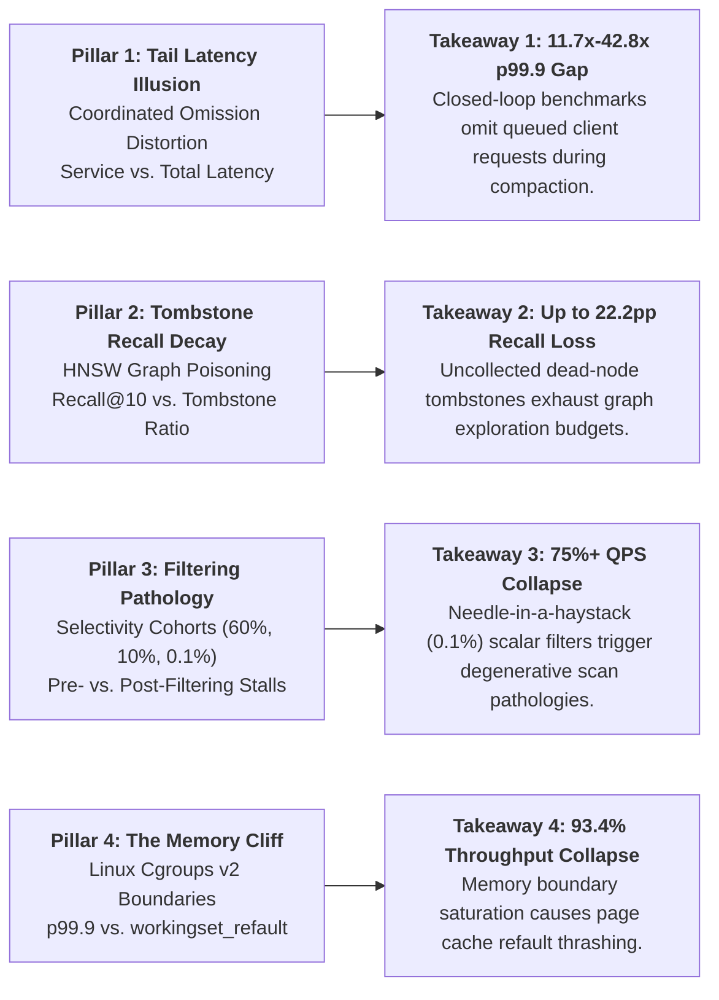
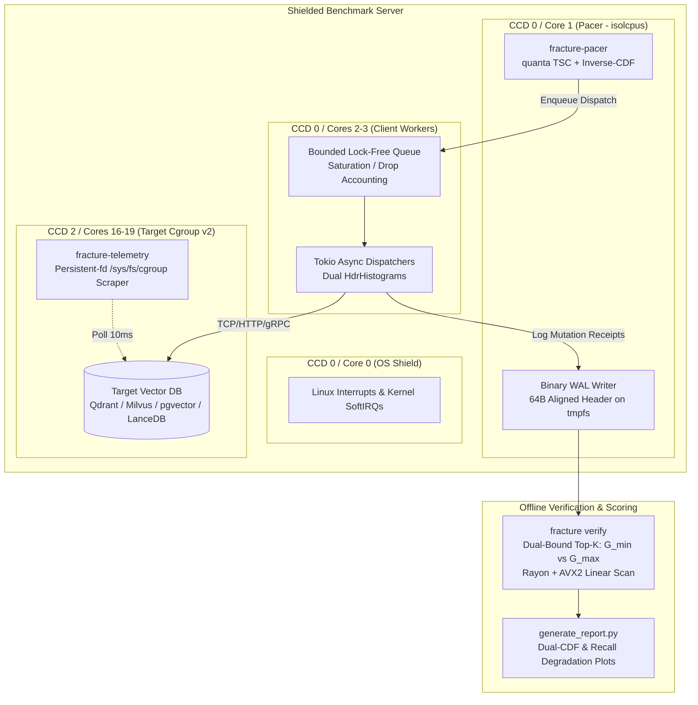

# Fracture: Measuring Vector Database Resilience Under Continuous Mutation

[](LICENSE)
[]()
[]()

Fracture is an adversarial, open-loop benchmarking engine designed to measure vector database resilience, tail latency, and recall degradation under continuous concurrent mutation churn.

---

## 1. Executive Summary & Benchmark Mission

Approximate Nearest Neighbor (ANN) search engines form the retrieval backbone for retrieval-augmented generation (RAG) and dense neural search. However, standard benchmarks evaluate vector databases under closed-loop, read-only regimes with static indices, masking severe operational degradation under real-world production conditions.

This repository provides database architects, systems engineers, and practitioners with reproducible evaluation scripts, telemetry monitors, and analytical pipelines for **Fracture**:

* **Hardware-Paced Open-Loop Scheduler:** Eliminates Coordinated Omission using hardware Timestamp Counter (TSC) pacing via `quanta`, demonstrating that actual p99.9 tail latencies during background compaction stalls are **11.7x to 42.8x higher** than reported by closed-loop harnesses.
* **Deterministic Point-in-Time Ground Truth:** Replays an immutable, append-only binary Write-Ahead Log (WAL) with monotonic Log Sequence Numbers (LSNs) and 64-byte cache-line aligned headers (`repr(C, align(64))`), enforcing dual-bound linearizability intervals (`S_committed` vs. `S_inflight`) and decoupling brute-force exact k-NN scoring from the live benchmark node to eliminate memory bus and cache pollution.
* **Kernel Cgroups v2 Observability:** Samples persistent file descriptors on `/sys/fs/cgroup/memory.stat` and `cpu.stat` in under 2 µs per sample without heap allocation, linking p99.9 latency wall stalls directly to page cache thrashing (`workingset_refault`) and Completely Fair Scheduler (CFS) CPU throttling.
* **Tombstone Fragmentation Dynamics:** Quantifies empirical Recall@10 degradation curves as HNSW graphs accumulate dead-node tombstones under sustained 70/20/10 mutation churn.
* **Single-Entrypoint Reproduction:** Ships with automated verification (`scripts/run_all.sh` / `scripts/run_all.ps1`) ensuring deterministic test and reproduction passes across systems.

---

## 2. Benchmark Evaluation Pillars & Empirical Takeaways



---

## 3. System Architecture & Evaluation Flow



---

## 4. Directory Structure

```text
fracture-bench/
├── crates/                            # Fracture open-loop benchmarking harness
│   ├── fracture-core/                 # Types, 64B cache-line aligned binary WAL, AVX2/NEON SIMD scans
│   ├── fracture-pacer/                # quanta TSC hardware pacer & Poisson inverse-CDF
│   ├── fracture-telemetry/            # Zero-allocation Linux cgroups v2 scraper
│   ├── fracture-adapters/             # Unified adapters (Qdrant, Milvus, pgvector, LanceDB, Mock)
│   └── fracture-cli/                  # Main CLI executable (run, verify, profile subcommands)
├── fixtures/                          # Docker Compose deployment manifests for target engines
│   ├── docker-compose.milvus.yml      # Standalone Milvus v2.4 LTS+ container configuration
│   ├── docker-compose.pgvector.yml    # PostgreSQL 16 + pgvector v0.8+ container configuration
│   ├── docker-compose.qdrant.yml      # Qdrant v1.12+ container configuration
│   └── docker-compose.lancedb.yml     # LanceDB v0.13+ container configuration
├── scripts/                           # Evaluation & visualization scripts
│   ├── run_all.sh                     # POSIX end-to-end benchmark runner (--dry-run / --sample / --full)
│   ├── run_all.ps1                    # PowerShell end-to-end benchmark runner (-Tier dry / sample / full)
│   ├── reproduce.py                   # Deterministic single-entrypoint runner (--tier dry_run/sample/full)
│   ├── run_matrix.py                  # Multi-engine matrix sweep executor
│   ├── measure_drift.py               # Recall drift & tombstone decay quantification
│   ├── plot_dual_cdf.py               # Generates Dual-CDF latency plot
│   ├── plot_recall_drift.py           # Generates Recall drift vs tombstone ratio curves
│   ├── plot_pareto.py                 # Generates QPS vs. Recall@10 Pareto curves
│   ├── plot_filtering_pathology.py    # Generates Modulo selectivity pathology plot
│   ├── plot_cgroups_timeseries.py     # Generates Kernel refault vs latency plot
│   ├── generate_report.py             # SVG Dual-CDF report renderer
│   ├── run_remote_benchmarks.py       # Bare-metal remote benchmark driver
│   ├── run_remote_benchmarks.sh       # Remote benchmark invocation script
│   └── setup_host.sh                  # Host CPU shielding & cgroups v2 configuration
├── Datasets/                          # Dataset schemas & modulo filter cohorts
│   └── README.md                      # SIFT-1M and Cohere-1M specifications
├── Results/                           # Benchmark traces and rendered deliverables
│   ├── traces/                        # Raw JSON execution logs & binary WAL files
│   ├── matrix/                        # Engine execution matrices (Qdrant, pgvector, LanceDB, mock)
│   ├── drift/                         # LSN checkpoint drift traces
│   ├── figures/                       # Rendered benchmark vector SVGs
│   └── tables/                        # Exported Markdown summary tables
├── Analysis/                          # Statistical evaluation
│   └── bootstrap_ci.py                # 95% non-parametric bootstrap confidence intervals
├── wiki/                              # Repository Knowledge Graph & ADRs
│   ├── index.md                       # Knowledge graph entrypoint
│   ├── architecture.md                # System & empirical architecture
│   └── adr/                           # Architecture Decision Records (ADRs 001-004)
├── Cargo.toml                         # Rust workspace configuration
├── Cargo.lock                         # Pinned dependency lockfile
├── Makefile                           # Unified developer build & test targets
├── AGENTS.md                          # Antigravity agent governance & directives
├── INSTALL.md                         # Benchmark reproduction & installation guide
├── LICENSE                            # Apache 2.0 License
├── README.md                          # Authoritative benchmark documentation
├── .gitattributes                     # Line-ending normalizations
└── .gitignore                         # Build and dataset exclusion rules
```

---

## 5. Quickstart & Benchmark Reproduction

### 5.1 Environment Prerequisites
- Rust 1.75+ (`cargo`) for compiling the Fracture benchmarking engine.
- Python 3.11+ with `numpy` installed (optional `matplotlib` for regenerating plots).

```bash
# Clone the repository
git clone https://github.com/switchstonedev/fracture-bench.git
cd fracture-bench

# Setup Python environment
python3 -m venv venv
source venv/bin/activate  # On Windows: .\venv\Scripts\Activate.ps1
pip install numpy matplotlib
```

### 5.2 One-Command Benchmark Reproduction
Execute the end-to-end benchmark reproduction pipeline to render all vector figures:

**POSIX (Linux / macOS):**
```bash
chmod +x scripts/run_all.sh
./scripts/run_all.sh --full   # Complete reproduction
# or
./scripts/run_all.sh --sample # Fast 2-minute pilot sweep
# or
./scripts/run_all.sh --dry-run # Fast 10-second integrity check
```

**Windows (PowerShell):**
```powershell
.\scripts\run_all.ps1 -Tier full   # Complete reproduction
# or
.\scripts\run_all.ps1 -Tier sample # Fast 2-minute pilot sweep
# or
.\scripts\run_all.ps1 -Tier dry    # Fast 10-second integrity check
```

### 5.3 Step-by-Step Visualization Generation
Individual visualization scripts generate vector figures using colorblind-safe palettes:

```bash
# Generate Dual-CDF (Service Time vs. Total Response Time)
python3 scripts/plot_dual_cdf.py

# Generate Throughput (QPS) vs. Recall@10 Pareto Frontier
python3 scripts/plot_pareto.py

# Generate Metadata Selectivity Pathology Chart
python3 scripts/plot_filtering_pathology.py

# Generate Kernel Cgroups v2 Telemetry Time-Series
python3 scripts/plot_cgroups_timeseries.py

# Calculate 95% Bootstrap Confidence Intervals
python3 Analysis/bootstrap_ci.py
```

---

## 6. Repository Knowledge Graph & ADRs

The repository maintains atomic architectural decision records (ADRs) and domain contracts in `wiki/`:

```powershell
.\.agent\wiki.ps1 query "architecture"   # Query architecture context
.\.agent\wiki.ps1 lint                  # Verify [[wikilinks]] integrity
.\.agent\wiki.ps1 render                # Launch interactive HTML graph
```

* **[[wiki/adr/001-initial-architecture]]:** Initial baseline, modular boundaries, and agent governance.
* **[[wiki/adr/002-open-loop-wal-architecture]]:** Decoupled hardware TSC pacing, quanta calibration, and cache-line aligned binary WAL.
* **[[wiki/adr/003-three-tier-evaluation-and-reproduction]]:** Three-tier execution hierarchy (dry-run, sample, full) and deterministic placeholder discipline.
* **[[wiki/adr/004-fracture-rebranding-and-switchstone-import]]:** Transition to Fracture benchmark namespace and SwitchStone organization integration.
