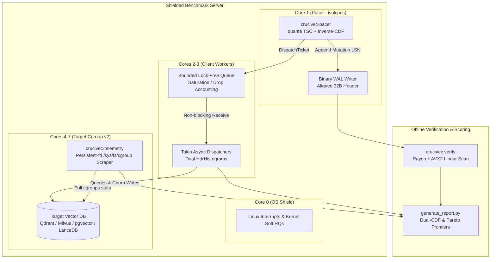

# CruciVec: The Open-Loop, Vendor-Neutral Crucible for Vector Databases

[]()
[]()
[]()
[](LICENSE)
[]()

CruciVec is an adversarial, open-loop benchmarking harness for vector search engines. It replaces synthetic "clean room" evaluations with realistic production workloads: continuous 70/20/10 mutation churn, hard deletes, HNSW graph fragmentation (dead-node tombstones), stratified metadata filtering, and strict kernel cgroups v2 memory budgets.

---

## 1. System Architecture



CruciVec isolates load generation, target execution, kernel telemetry, and mathematical scoring into independent subsystems to eliminate measurement perturbation:

*   **`crucivec-pacer`:** High-precision arrival scheduler running on an isolated, pinned CPU core. Uses hardware Timestamp Counter (`quanta`) to drive Poisson arrivals with sub-microsecond jitter at 50,000 QPS.
*   **`crucivec-core`:** Domain types, 32-byte naturally aligned binary Write-Ahead Log (WAL), and AVX2/NEON SIMD linear-scan $k$-NN kernels for decoupled ground-truth calculation.
*   **`crucivec-telemetry`:** Zero-allocation Linux `/sys/fs/cgroup` parser sampling page faults, workingset refaults, and CFS CPU throttling in under 2 µs per sample using persistent file descriptors.
*   **`crucivec-adapters`:** Unified client trait implementations for Qdrant (gRPC), pgvector (tokio-postgres), Milvus, and LanceDB (isolated).
*   **`crucivec-cli`:** Main executable binary with `run`, `verify`, and `profile` subcommands.

---

## 2. Core Invariants

1. **Elimination of Coordinated Omission:**
   CruciVec tracks dual histograms per worker task:
   *   `service_time`: Network round-trip duration ($t_{\text{recv}} - t_{\text{sent}}$).
   *   `total_response_time`: True end-to-end latency including client queue delay ($t_{\text{recv}} - t_{\text{intended}}$).
2. **Deterministic Point-in-Time Ground Truth:**
   Ground truth is never evaluated against mutable live state. Mutations are appended to an immutable binary WAL with monotonic Log Sequence Numbers (LSNs). Queries record their observed commit boundary, and ground-truth nearest neighbors are reconstructed post-hoc.
3. **Decoupled Ground-Truth Computation:**
   Brute-force SIMD scans are executed offline to prevent memory bus and cache pollution during the live benchmark run.
4. **Stratified Modulo Selectivity:**
   Metadata filter queries are partitioned into three calibrated cohorts:
   *   High Selectivity: ~60% match rate (`id % 10 in [0..5]`).
   *   Medium Selectivity: ~10% match rate (`id % 10 == 0`).
   *   Needle-in-a-Haystack: ~0.1% match rate (`id % 1000 == 42`).

---

## 3. Quick Start

### Build CruciVec
```bash
cargo build --release
```

### Run an Open-Loop Benchmark
```bash
./target/release/crucivec run \
    --target qdrant \
    --qps 10000 \
    --workload churn-70-20-10 \
    --dataset cohere-1m
```

### Replay WAL for Offline Recall@K Verification
```bash
./target/release/crucivec verify \
    --wal-path ./runs/qdrant_churn.wal \
    --queries ./data/cohere_queries.bin \
    --k 10
```

---

## 4. Repository Knowledge Graph

Architectural Decision Records (ADRs) are documented in `wiki/`:
*   [[wiki/adr/001-initial-architecture]]: Foundational baseline and modular boundaries.
*   [[wiki/adr/002-open-loop-wal-architecture]]: Pacer TSC design, bytemuck WAL layout, and SIMD linear scans.
