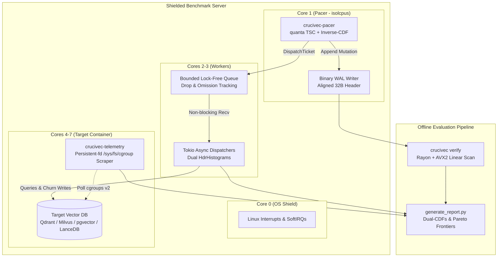

# System Architecture & Subsystem Boundaries

## 1. System Topology

## 2. Subsystem Layout
*   `crates/crucivec-pacer`: High-precision arrival scheduler running on an isolated, pinned CPU core.
*   `crates/crucivec-core`: Domain types, 32-byte naturally aligned binary Write-Ahead Log (WAL), and AVX2/NEON SIMD linear-scan $k$-NN kernels.
*   `crates/crucivec-telemetry`: Allocation-free Linux `/sys/fs/cgroup` parser.
*   `crates/crucivec-adapters`: Unified database client trait implementations.
*   `crates/crucivec-cli`: Main executable binary with `run`, `verify`, and `profile` subcommands.

## 3. Architecture Decision Records
*   Initial Baseline: [[wiki/adr/001-initial-architecture]]
*   Open-Loop WAL Architecture: [[wiki/adr/002-open-loop-wal-architecture]]
